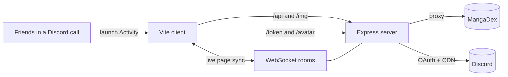

<div align="center">


### 📖 Read manga together, page by page, right inside a Discord call

<p>
  
  
  
  
  
</p>

<i>Pick something and everyone in the call reads along.</i>

</div>

---

## ✨ Features

<table>
<tr>
<td width="50%" valign="top">

### 🤝 Read together
- **Live page sync.** Turn a page and everyone in the Activity follows
- **Late joiners** jump straight to the current chapter and page
- **Who's here.** Participant avatars, with a highlight on whoever is leading
- **Follow toggle.** Turn it off to read ahead on your own, back on to catch up
- Toasts when someone opens a new chapter

</td>
<td width="50%" valign="top">

### 📚 Reading experience
- **Strip mode** (vertical scroll) or **Pages mode** (one page at a time)
- **RTL / LTR** reading direction for traditional manga
- **HD toggle.** Switch between data-saver and full-quality images
- **Page slider.** Drag to jump anywhere in a chapter
- Next-page preloading and keyboard shortcuts

</td>
</tr>
<tr>
<td width="50%" valign="top">

### 🔎 Discover
- Search the full MangaDex catalogue
- **Popular** and **Latest updates** shelves on the home screen
- English chapters with scanlation group credits

</td>
<td width="50%" valign="top">

### 💾 Remembers you
- **Continue reading** with per-series progress bars
- **Your library.** Star series to keep them on the home screen
- Settings saved in your browser

</td>
</tr>
</table>

---

## 🧭 How it works



Everyone in the same Activity shares one Discord `instanceId`, which works as their sync room. The server keeps the room's current chapter and page and broadcasts every page turn to the others.

---

## 🚀 Getting started

### Prerequisites
- **Node.js 20.6+**
- A Discord application with **Activities** enabled ([Developer Portal](https://discord.com/developers/applications))
- A tunnel such as [`cloudflared`](https://developers.cloudflare.com/cloudflare-one/connections/connect-networks/) so Discord can reach your local server

### 1. Clone and install

```bash
git clone https://github.com/IchizaCode/Discord_MangaReader.git
cd Discord_MangaReader
npm install
```

### 2. Configure environment

Create a `.env` file in the project root:

```env
VITE_CLIENT_ID=your_discord_application_id
DISCORD_CLIENT_SECRET=your_discord_client_secret
```

> [!NOTE]
> The client secret is only used to show avatars and who's in the call. Reading and syncing still work without it.

> [!WARNING]
> Never commit your `.env` file. Make sure it's listed in `.gitignore`.

### 3. Run it

Start the backend and the dev server in two terminals:

```bash
# Terminal 1: API proxy + WebSocket sync (port 3001)
node --env-file=.env server.js

# Terminal 2: Vite dev server
npm run dev
```

### 4. Expose it to Discord

```bash
cloudflared tunnel --url http://localhost:5173
```

In the Developer Portal, open **Activities → URL Mappings** and map `/` to your tunnel's host. Then launch the Activity from a voice channel. 🎉

> [!TIP]
> Opening the Vite URL in a normal browser also works. You'll join a shared `local-test` room, which is handy for testing sync across two tabs.

### 🏗️ Production

```bash
npm run build
node --env-file=.env server.js   # serves /dist on http://127.0.0.1:3001
```

---

## ⌨️ Keyboard shortcuts

| Mode | Key | Action |
| :-- | :-: | :-- |
| **Pages** | `→` / `Space` | Next page *(`←` when RTL is on)* |
| **Pages** | `←` | Previous page *(`→` when RTL is on)* |
| **Strip** | `→` | Next chapter |
| **Strip** | `←` | Previous chapter |

---

## 🗂️ Project structure

```
Discord_MangaReader/
├── public/
│   └── favicon.svg
├── src/
│   ├── main.js        # UI, reader, Discord SDK, sync client
│   └── style.css
├── index.html
├── server.js          # Express proxies + WebSocket rooms
├── vite.config.js     # Dev proxy to the backend
└── package.json
```

---

## 🙏 Credits

- Manga data and images from [**MangaDex**](https://mangadex.org). Please support the scanlation groups credited on each chapter.
- Built with the [**Discord Embedded App SDK**](https://github.com/discord/embedded-app-sdk).

<div align="center">

<br />

**If you enjoy reading with friends, consider leaving a ⭐**


</div>
